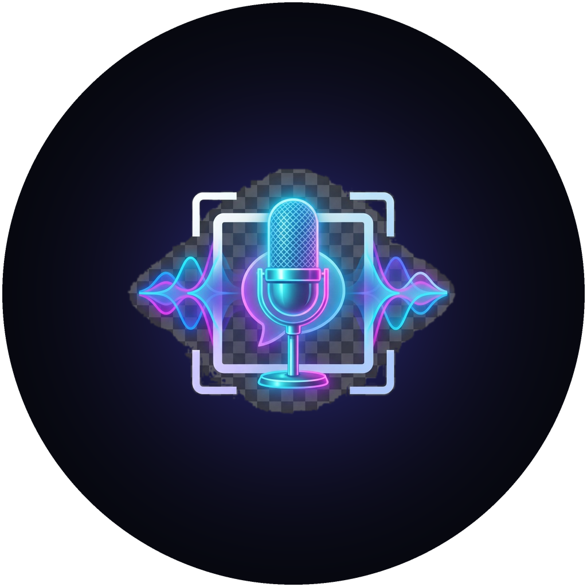
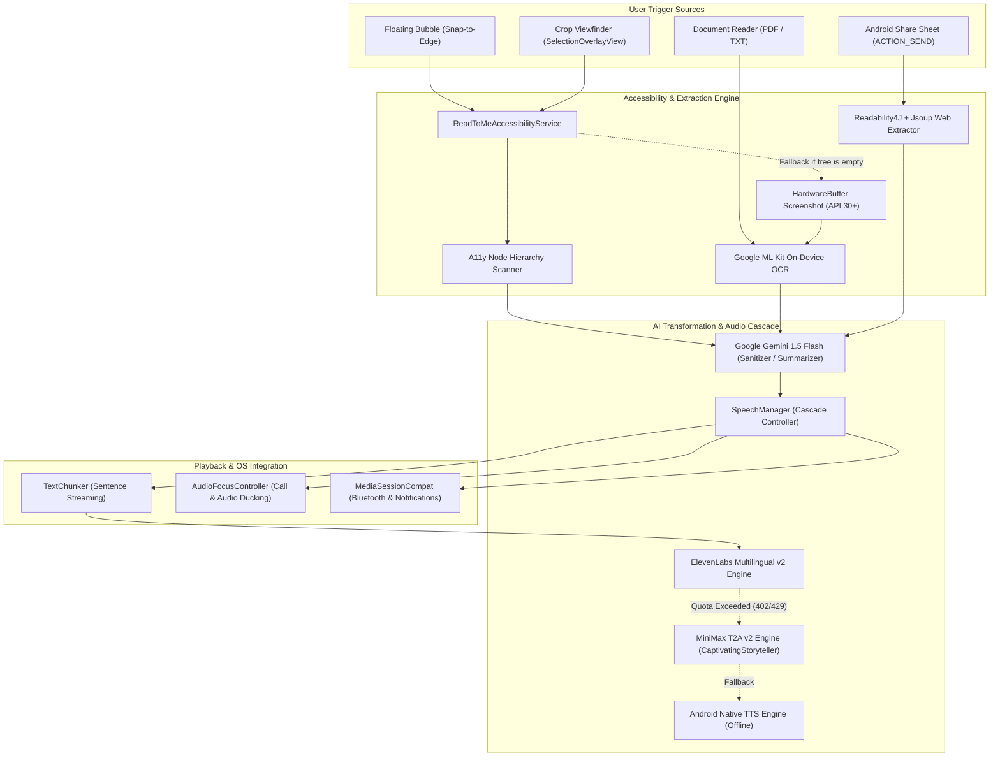

<div align="center">

# 🎙️ ReadToMe

**Intelligent On-Demand Screen, Document & Web Reader for Android (API 30–36+)**

[](https://developer.android.com)
[-blue.svg?style=flat)](https://developer.android.com/about/versions/16)
[](https://kotlinlang.org)
[-4285F4.svg?style=flat&logo=jetpackcompose)](https://developer.android.com/jetpack/compose)
[](https://elevenlabs.io)
[](https://ai.google.dev)

*Listen to anything on your phone in natural human voice: tap the floating bubble to read any screen or cropped selection, extract and summarize web links, or read PDF and TXT documents with intelligent multi-tier AI fallback.*

[Português (README.pt-BR.md)](README.pt-BR.md)

</div>

---

## 📸 App Icon & Visual Identity

<div align="center">
  <table>
    <tr>
      <td align="center"><b>Standard Launcher Icon (Android Squircle)</b></td>
      <td align="center"><b>Circular Mask (Samsung One UI / Google Pixel)</b></td>
    </tr>
    <tr>
      <td align="center">
        
      </td>
      <td align="center">
        
      </td>
    </tr>
  </table>
</div>

---

## 💡 The Problem

Modern smartphones are flooded with content — lengthy web articles, scanned PDFs, social messaging feeds, and complex app screens. Existing screen readers are either:
- **Intrusive Accessibility Suites (e.g. TalkBack):** Designed for full navigation assistance, reading every button, label, and coordinate on screen rather than flowing content.
- **Single-Source Text Readers:** Confined to their own internal reading library, unable to read text across arbitrary third-party apps, games, or social feeds.
- **Fragile Cloud TTS:** Apps that rely strictly on a single cloud voice provider break completely when monthly API credits run dry or when offline.

---

## ⚡ The Solution: ReadToMe

**ReadToMe** is a personal, production-grade Android audio assistant engineered for seamless, on-demand listening:

1. **Floating Screen Overlay (`TYPE_ACCESSIBILITY_OVERLAY`):** A discreet, draggable bubble with magnetic snap-to-edge. Tap to read the entire screen or drag a crop box to read any specific region.
2. **Hybrid Content Extraction:**
   - **Fast-path (Accessibility Node Tree):** Recursively inspects visible UI hierarchy nodes for instantaneous, zero-latency text extraction (WhatsApp, Telegram, Twitter/X, news apps).
   - **Visual Fallback (Google ML Kit OCR):** Captures hardware buffer screenshots via Android 11+ `takeScreenshot()` and applies on-device machine learning OCR for scanned text, charts, images, and games.
3. **Smart Web Link Reader:** Share any URL from Chrome or paste a link. ReadToMe strips ads, navigation bars, and cookie banners with **Readability4J**, and optionally summarizes it into a fluid radio/podcast script using **Google Gemini 1.5 Flash**.
4. **Universal Document Reader:** Import or share PDF and TXT files. PDFs are rendered page-by-page with native `PdfRenderer` and parsed with ML Kit OCR.
5. **Intelligent Auto-Cascade Voice Engine:**
   - 🥇 **Primary:** **ElevenLabs Multilingual v2** (ultra-realistic human voices).
   - 🥈 **Secondary Fallback:** **MiniMax T2A v2** (`Portuguese_CaptivatingStoryteller`, `speech-2.8-hd` / `speech-2.8-turbo` via `platform.minimax.io`).
   - 🥉 **Offline Fallback:** **Android Native TTS** (guarantees audio plays even offline or without credits).
   - If ElevenLabs exhausts credits (HTTP 401/402/429), it switches to MiniMax instantly without losing speech progress.

---

## ✨ Features

- 🎯 **Interactive Selection Overlay:** Fullscreen crop overlay with high-contrast neon cyan dashed viewfinder borders and black shadows visible against any background.
- 🎛️ **Expandable Floating Mini-Player:** Play, pause, stop, and toggle speech speed (1.0x, 1.5x, 2.0x) directly from the floating bubble without switching apps.
- ⚡ **Zero-Latency Audio Chunking (`TextChunker`):** Natural sentence splitting (`.`, `!`, `?`, `;`, line breaks) starts audio playback in under 300ms while remaining chunks stream in background.
- 🎧 **Full Media Session & Audio Focus:** Seamless integration with `MediaSessionCompat` for Bluetooth headphone controls (play/pause buttons) and dynamic audio ducking/pause during phone calls and voice notes.
- 🎨 **Modern Cyber-Studio UI (Jetpack Compose / Material 3):** Clean dark obsidian theme with dual API key managers, real-time connection badges (`● Ativa` / `○ Pendente`), voice speed controls, and a toggle to show/hide the floating bubble.
- 🔒 **Privacy First:** Keys are encrypted and stored in local `EncryptedSharedPreferences`. On-device OCR processes screenshots in memory without external telemetry.

---

## 🛠️ Architecture & Tech Stack



- **Language:** Kotlin 2.1
- **UI Toolkit:** Jetpack Compose (Material 3) Edge-to-Edge
- **Target SDK:** Android 16 (API 36) / Minimum SDK: Android 11 (API 30)
- **Audio Engines:** ElevenLabs REST API, MiniMax T2A v2 REST API, Android Native `TextToSpeech`
- **OCR Engine:** Google ML Kit Text Recognition (`com.google.android.gms:play-services-mlkit-text-recognition`)
- **Web Parsing:** Readability4J & Jsoup
- **AI Processing:** Google GenAI / Gemini 1.5 Flash SDK
- **Architecture Pattern:** Clean Architecture with Repository Pattern and Reactive State Flow

---

## 🚀 Getting Started

### 1. Build & Install the App

Clone the repository and build the debug APK using the Gradle wrapper:

```bash
git clone https://github.com/dellanio/read-to-me.git
cd read-to-me

# Build debug APK
./gradlew assembleDebug

# Install on connected device
adb install -r app/build/outputs/apk/debug/app-debug.apk
```

### 2. Enable Accessibility Service

1. Open **ReadToMe** on your smartphone.
2. Tap the banner button **"Ativar ReadToMe Agora"**.
3. In Android's **Installed Apps / Accessibility Services**, toggle **ReadToMe** to **ON**.
4. The floating neon bubble will appear docked at the edge of your screen!

### 3. Configure AI Voice Keys (Optional but Recommended)

In the app's **Configurações de Voz**:
- **ElevenLabs API Key:** Paste your key for ultra-realistic studio narration.
- **MiniMax API Key:** Paste your key from [platform.minimax.io](https://platform.minimax.io) to activate the automatic quota fallback with the `Portuguese_CaptivatingStoryteller` neural voice.
- **Gemini API Key:** Paste your Google AI Studio key to enable smart OCR cleanup and web article summarization.

---

## 📱 How to Use

| Action | How to Trigger | What Happens |
| :--- | :--- | :--- |
| **Read Entire Screen** | Tap the floating bubble | Inspects the active app's node tree or falls back to OCR, then begins reading aloud immediately. |
| **Read Selection / Crop** | Long-press or tap selection icon on bubble | Displays the neon crop reticle. Drag across the screen to crop any text or image area and tap **Ouvir Seleção**. |
| **Listen to Web Articles** | Share any link via Android Share Sheet | Strips ads and cookies with Readability4J, summarizes via Gemini, and plays audio. |
| **Read PDF / TXT** | Tap **"Ler Documento (PDF / TXT)"** or share PDF | Parses pages, performs on-device OCR, and begins streaming audio. |
| **Mini-Player Controls** | Tap bubble while audio is playing | Expands into Play/Pause, Stop, and 1.0x / 1.5x / 2.0x speed selector. |

---

## 🔒 Security & Privacy Model

- **Local-First Processing:** Screen OCR via Google ML Kit runs entirely on-device with zero cloud uploads of your screen pixels.
- **Zero Background Spying:** The Accessibility Service only accesses window content or screenshots upon explicit user tap on the floating bubble or selection reticle.
- **Encrypted Local Storage:** All API keys (ElevenLabs, MiniMax, Gemini) are stored locally using Android `EncryptedSharedPreferences`.
- **Sanitized Sharing:** URLs shared from social media or news apps have tracking query parameters cleaned before extraction.

---

## 📄 License

This project is licensed under the MIT License. See [LICENSE](LICENSE) for details.
