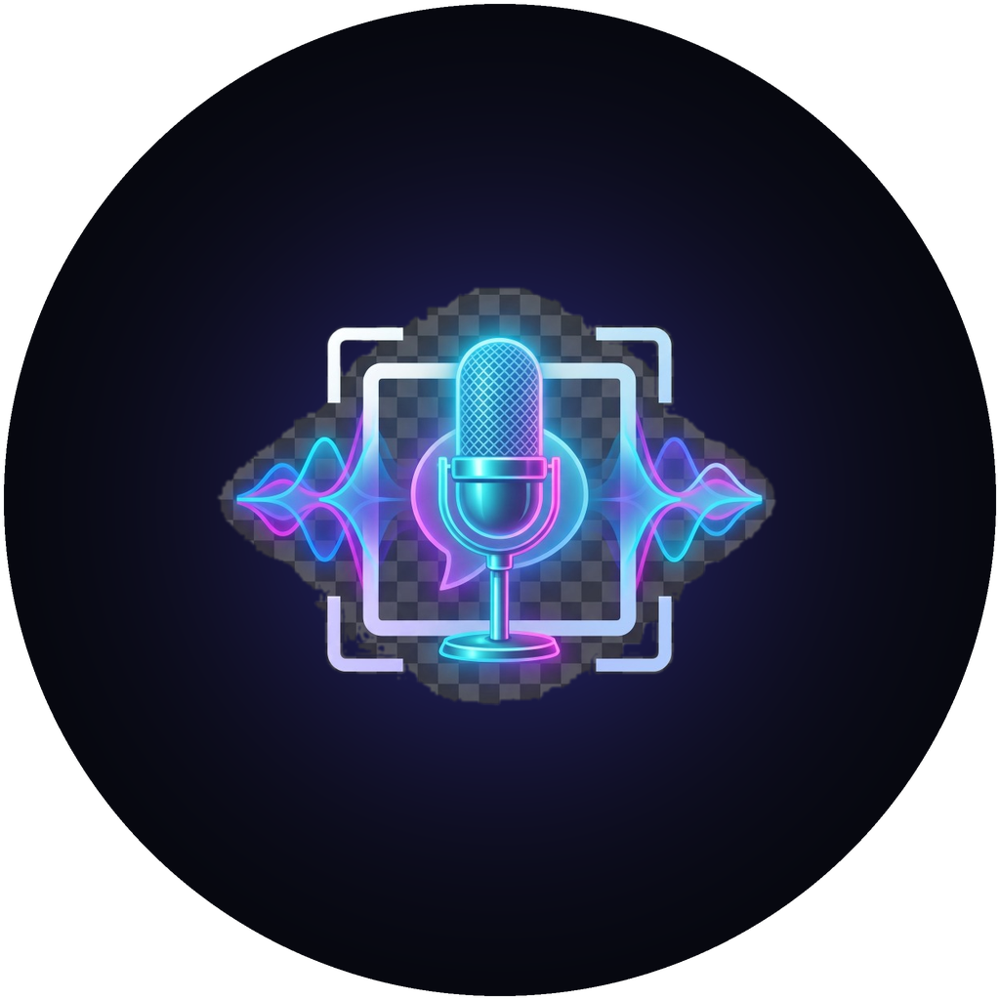

# 🎙️ ReadToMe (Português)

Aplicativo Android nativo de produção para leitura de tela sob demanda, documentos e páginas web com síntese de voz neural avançada (ElevenLabs e MiniMax) e inteligência artificial (Android 11 a 16+).

[English Version (README.md)](README.md)

---

## 📸 Identidade Visual e Ícone do App

<div align="center">
  <table>
    <tr>
      <td align="center"><b>Ícone Launcher Padrão (Squircle)</b></td>
      <td align="center"><b>Máscara Circular (Samsung One UI / Pixel)</b></td>
    </tr>
    <tr>
      <td align="center">
        
      </td>
      <td align="center">
        
      </td>
    </tr>
  </table>
</div>

---

## ⚡ Recursos Principais

1. **Botão Flutuante e Mini-Player (`TYPE_ACCESSIBILITY_OVERLAY`)**:
   - Ícone flutuante discreto com arrasto suave e magnetismo para colar nas bordas da tela (*Snap-to-Edge*).
   - Expande em um **Mini-Player** durante a reprodução com botões de Play/Pause, Stop e alternador de velocidade (1.0x, 1.5x, 2.0x).
   - Preferência para exibir ou ocultar o botão flutuante em tempo real.

2. **Captura Híbrida Inteligente de Tela**:
   - **Caminho Rápido (Árvore de Acessibilidade):** Varre os nós da tela instantaneamente para leitura rápida de mensagens (WhatsApp, Telegram, Twitter/X) e feeds sem latência.
   - **Fallback com OCR no Aparelho (Google ML Kit):** Para jogos, imagens e textos digitalizados, captura a tela via `takeScreenshot()` do Android e extrai o texto com OCR local acelerado por hardware.

3. **Retículo de Seleção na Tela (Crop)**:
   - Overlay edge-to-edge com bordas tracejadas neon em alto contraste e sombra preta visível sobre qualquer aplicativo ou fundo.
   - Permite arrastar o dedo para selecionar e ler apenas a área desenhada na tela ou ler a tela inteira com 1 toque.

4. **Leitor de Artigos Web com Sanitização e Resumo IA**:
   - Integração com o menu de Compartilhamento do Android (*Share Sheet*).
   - Remove anúncios, pop-ups, rodapés e cookies usando **Readability4J** e **Jsoup**.
   - Converte notícias em resumos fluidos no estilo podcast/rádio com **Google Gemini 1.5 Flash**.

5. **Leitor Universal de Documentos (PDF e TXT)**:
   - Suporte a arquivos de texto simples (TXT) com codificação UTF-8.
   - Renderização página por página de PDFs nativamente com `PdfRenderer` e OCR integrado via Google ML Kit com barra de progresso.

6. **Cascata de Voz Inteligente com Fallback Automático**:
   - 🥇 **Principal:** **ElevenLabs Multilingual v2** (vozes neurais ultra-realistas).
   - 🥈 **Fallback Automático:** **MiniMax T2A v2** (`platform.minimax.io`) com a voz `Portuguese_CaptivatingStoryteller` (modelos `speech-2.8-hd` e `speech-2.8-turbo`, com reforço em português).
   - 🥉 **Fallback Offline:** **Android Native TTS** (garante leitura mesmo sem internet ou sem créditos).
   - Troca automática quando os créditos da ElevenLabs se esgotam (erros 401, 402, 429), mantendo o fluxo do texto sem interrupção.

7. **Interface Moderna em Jetpack Compose (Material 3)**:
   - Configuração de chaves de API com status visual em tempo real (`● Ativa` / `○ Pendente`).
   - Prévia e teste de voz instantâneo.
   - Chave de exibição do botão flutuante e preferências do sistema.

---

## 🚀 Como Compilar e Instalar

```bash
# 1. Clonar repositório
git clone https://github.com/dellanio/read-to-me.git
cd read-to-me

# 2. Compilar APK Debug
./gradlew assembleDebug

# 3. Instalar no aparelho via ADB
adb install -r app/build/outputs/apk/debug/app-debug.apk
```

---

## 🔒 Segurança e Privacidade

- **Chaves de API Criptografadas:** Armazenadas de forma segura utilizando `EncryptedSharedPreferences`.
- **OCR 100% no Aparelho:** O reconhecimento de texto em tela ocorre em memória localmente via Google ML Kit, sem envio de imagens para a nuvem.
- **Acessibilidade Sob Demanda:** A leitura só é ativada quando o usuário toca explicitamente no botão flutuante ou no menu de compartilhamento.

---

## 📄 Licença

Distribuído sob a licença MIT. Consulte [LICENSE](LICENSE) para mais informações.
